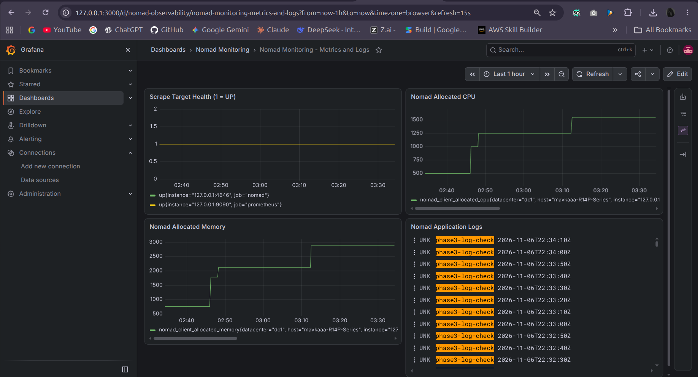
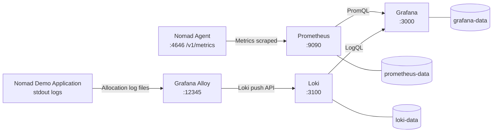
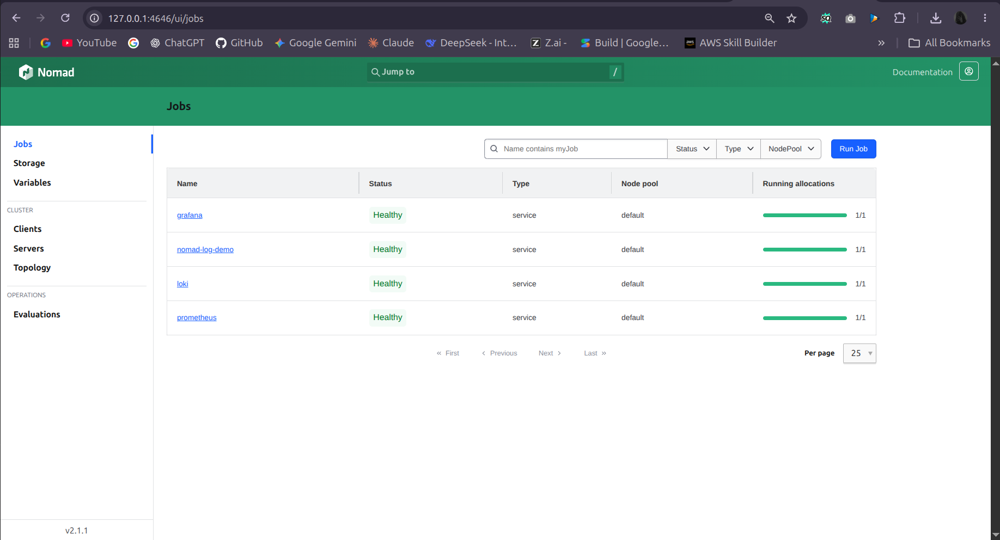
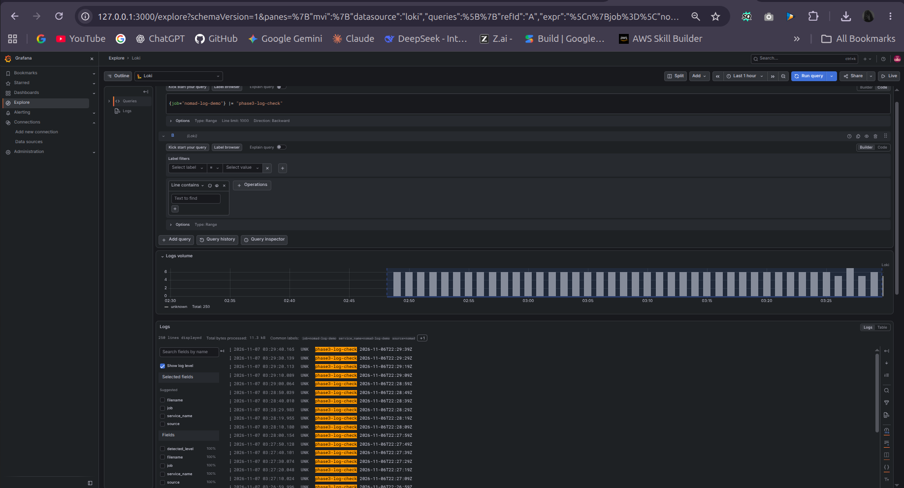

# Nomad Monitoring Stack — Prometheus, Grafana, Loki & Alloy

**Containerized metrics monitoring and centralized application logging, orchestrated with HashiCorp Nomad.**

**Project status:** Completed and validated for a **single-node Ubuntu lab** · **Deployment:** Nomad + Docker · **Observability:** Metrics + Logs · **Evidence:** CLI/API tests and dashboard screenshots



> **Project at a glance:** A modular, local-first observability lab that collects Nomad and Prometheus metrics, forwards demo-application logs into Loki, and unifies both data sources in a provisioned Grafana dashboard. The repository includes pinned container images, Nomad job specifications, configuration files, persistent-storage setup instructions, test evidence, and operational documentation.

## Project objectives

This project was developed to demonstrate a practical **DevOps observability workflow** using a lightweight, single-node Nomad deployment. Its objectives are to:

1. **Monitor infrastructure orchestration:** Scrape Nomad agent metrics and Prometheus health metrics.
2. **Centralize application logs:** Collect a test application's stdout logs through Grafana Alloy and make them searchable in Loki.
3. **Visualize operational data:** Correlate service health, Nomad resource allocations, and application logs in Grafana.
4. **Preserve service data:** Mount dedicated host storage for Prometheus, Loki, and Grafana.
5. **Document reproducible configuration:** Supply versioned deployment files, setup guidance, and evidence-based validation for another compatible lab environment.

## Key features and project strengths

| Feature | Implementation |
| --- | --- |
| **Containerized & modular** | Separate Prometheus, Loki, and Grafana jobs; an Alloy sidecar alongside a demo application |
| **Unified observability** | PromQL metrics and LogQL logs available through provisioned Grafana data sources |
| **Nomad-native orchestration** | HCL job definitions, Docker task driver, and a single-node Nomad server/client |
| **Persistent local storage** | Three registered Nomad host volumes with dedicated on-host directories |
| **Version-controlled setup** | Pinned image versions, configuration files, dashboard JSON, and setup examples |
| **Evidence-backed validation** | Successful API/readiness checks, healthy jobs, scraped targets, and recent log queries |
| **Local-first access** | Grafana, Prometheus, Loki, and Alloy HTTP endpoints observed on loopback interfaces |

**Design boundary:** This is a **validated development/demo stack**, not a production-hardened, highly available observability service. A fresh-machine deployment has not yet been independently tested.

## Architecture



**Metrics path:** Nomad and Prometheus → Prometheus → Grafana.
**Logs path:** `log-demo` stdout → Alloy → Loki → Grafana.

For design decisions and component details, see [Architecture & Data Flows](docs/ARCHITECTURE.md).

## Technology stack

| Technology | Tested version / image | Role |
| --- | --- | --- |
| Ubuntu Linux | 26.04.1 LTS | Host operating system |
| HashiCorp Nomad | 2.1.1 | Workload orchestration (single-node `dc1`) |
| Docker Engine | 29.9.3 | Container runtime |
| Prometheus | `prom/prometheus:v3.13.5` | Metric collection and PromQL queries |
| Grafana Loki | `grafana/loki:3.7.9` | Log ingestion, storage, and LogQL queries |
| Grafana Alloy | `grafana/alloy:v1.21.3` | Demo-application log collection and forwarding |
| Grafana | `grafana/grafana:13.3.0` | Dashboards and observability UI |
| BusyBox | `busybox:1.37.0` | Test log generator in `nomad-log-demo` |

### Deployed Nomad jobs

- `prometheus` — self-monitoring and Nomad metrics scraping.
- `loki` — single-instance log backend.
- `nomad-log-demo` — `log-demo` application task and `alloy` collector task.
- `grafana` — provisioned Prometheus/Loki data sources and monitoring dashboard.

## Dashboard and visual evidence

The provisioned **Nomad Monitoring - Metrics and Logs** dashboard has four panels:

| Dashboard panel | What it actually measures |
| --- | --- |
| **Scrape Target Health** | `up{job=~"nomad\|prometheus"}` — health of the two Prometheus scrape targets |
| **Nomad Allocated CPU** | `nomad_client_allocated_cpu` — CPU allocations, **not** actual host CPU utilization |
| **Nomad Allocated Memory** | `nomad_client_allocated_memory` — allocated memory, **not** physical RAM consumed |
| **Nomad Application Logs** | `{job="nomad-log-demo"} \|= "phase3-log-check"` — matching demo application logs |

### Additional verification screenshots

| Healthy Nomad jobs | Loki application log ingestion |
| :---: | :---: |
| [](screenshots/03-nomad-jobs-health-status.png) | [](screenshots/02-loki-log-ingestion-verification.png) |

Other evidence: [Prometheus metrics query](screenshots/01-prometheus-metrics-query-verification.png) · [Recent application logs](screenshots/05-loki-realtime-application-logs.png) · [Allocation task health](screenshots/06-nomad-allocation-task-health.png) · [Nomad client resources](screenshots/07-nomad-client-resource-monitoring.png).


## Getting started

### Prerequisites

A compatible **Ubuntu/Linux host** with Docker Engine and a working **Nomad server + client**, including a healthy Docker task driver. The project was tested on Ubuntu 26.04.1 LTS. Make sure ports `3000`, `3100`, `9090`, and `12345` are available on the lab machine.

### 1. Clone this repository

```bash
git clone https://github.com/YOUR_USERNAME/nomad-monitoring-stack.git
cd nomad-monitoring-stack
```

Replace `YOUR_USERNAME` with the repository owner's GitHub username once the public repository has been created.

### 2. Prepare storage on a **new** lab system

```bash
./scripts/prepare-storage.sh
```

This script creates the dedicated Prometheus, Loki, and Grafana directories under `/var/lib/nomad-monitoring/` with the expected ownership and permissions. **Do not run it unnecessarily on an existing production system.**

### 3. Configure the Nomad agent

Enable Prometheus-compatible Nomad telemetry, and merge the three host-volume definitions from [`setup/nomad-client-volumes.example.hcl`](setup/nomad-client-volumes.example.hcl) into the **existing** Nomad client configuration. Do not paste those host volumes outside the `client {}` block or replace an existing agent configuration blindly.

Validate the Nomad agent configuration before restarting an agent on the **new lab system**:

```bash
sudo nomad config validate /etc/nomad.d
```

See the [Quick Start Guide](docs/QUICKSTART.md) for the complete fresh-install procedure, including the agent restart and checks.

### 4. Deploy the four job specifications

From the repository root, **on the new lab system only**:

```bash
nomad job validate jobs/prometheus.nomad.hcl
nomad job run jobs/prometheus.nomad.hcl

nomad job validate jobs/loki.nomad.hcl
nomad job run jobs/loki.nomad.hcl

nomad job validate jobs/alloy.nomad.hcl
nomad job run jobs/alloy.nomad.hcl

nomad job validate jobs/grafana.nomad.hcl
nomad job run jobs/grafana.nomad.hcl
```

Run the jobs in this order and check that each service is healthy before proceeding. These commands are **not required on the already-running original lab**.

### 5. Verify service readiness

```bash
nomad job status
curl -fsS http://127.0.0.1:9090/-/ready
curl -fsS http://127.0.0.1:3100/ready
curl -fsS http://127.0.0.1:12345/-/ready
curl -fsS http://127.0.0.1:3000/api/health
```

Open the dashboard on the lab host:

**http://127.0.0.1:3000/d/nomad-observability**

Secure the Grafana administrator account after installation. Do not commit access credentials to Git.

### 6. Confirm metrics and logs

**Prometheus:**

```bash
curl -fsS -G http://127.0.0.1:9090/api/v1/query \
  --data-urlencode 'query=up{job=~"prometheus|nomad"}' \
  | python3 -m json.tool
```

**Loki (last 10 minutes):**

```bash
curl -fsS -G http://127.0.0.1:3100/loki/api/v1/query_range \
  --data-urlencode 'query={job="nomad-log-demo"} |= "phase3-log-check"' \
  --data-urlencode 'since=10m' \
  --data-urlencode 'limit=10' \
  | python3 -m json.tool
```

Log results depend on the demo job continuing to emit messages within the queried interval.

## Validated results

The original Ubuntu lab was checked using the Nomad CLI, service readiness endpoints, Prometheus and Loki APIs, Grafana dashboard, Docker resource snapshots, and filesystem inspection.

| Validation | Observed result |
| --- | --- |
| Nomad deployments | Four jobs healthy at the recorded validation time |
| Prometheus target health | Both `prometheus` and `nomad` targets returned `up = 1` |
| Loki log ingestion | Successful query returned 10 recent matching test log entries |
| Grafana | Database health OK and four-panel dashboard displaying data |
| Persistent storage | Three host volumes registered and correctly mounted |
| Network exposure | Monitoring service HTTP ports observed bound to `127.0.0.1` |
| Non-disruptive test coverage | CLI/API and dashboard checks passed; no forced failures introduced |

**Evidence:** [`docs/TEST-REPORT.md`](docs/TEST-REPORT.md) · [`reports/phase5/`](reports/phase5/) · [`screenshots/`](screenshots/).

## Repository structure

```text
nomad-monitoring-stack/
├── .gitignore
├── README.md
├── jobs/                         # Nomad HCL job definitions
├── config/                       # Prometheus, Loki, Alloy, Grafana provisioning
├── dashboards/
│   └── nomad-observability.json
├── scripts/
│   └── prepare-storage.sh
├── setup/
│   └── nomad-client-volumes.example.hcl
├── docs/
│   ├── QUICKSTART.md
│   ├── ARCHITECTURE.md
│   ├── DEPLOYMENT-AND-VERIFICATION.md
│   ├── TEST-REPORT.md
│   ├── OPERATIONS-RUNBOOK.md
│   ├── DELIVERY-CHECKLIST.md
│   └── FINAL-COMPLETION-REPORT.md
├── reports/
│   ├── phase5/                  # Captured validation outputs
│   └── phase6/                  # Final completion report
└── screenshots/                 # Seven named proof images
```

## Documentation

- [**Quick Start** — install on another compatible lab host](docs/QUICKSTART.md)
- [Architecture — services, data flows, and storage](docs/ARCHITECTURE.md)
- [Deployment & Verification — configuration history and checks](docs/DEPLOYMENT-AND-VERIFICATION.md)
- [Testing Report — recorded validation and evidence](docs/TEST-REPORT.md)
- [Operations Runbook — troubleshooting and operating notes](docs/OPERATIONS-RUNBOOK.md)
- [Delivery Checklist — handover requirements](docs/DELIVERY-CHECKLIST.md)
- [Final Completion Report — project outcome](reports/phase6/FINAL-COMPLETION-REPORT.md)

## Known limitations and security notes

- **Single-node architecture:** No demonstrated high availability or failover.
- **Limited log coverage:** Alloy was verified for `nomad-log-demo` stdout only, not every host or Nomad application.
- **Persistent volumes are not backups:** Forced-restart recovery and backup restoration were **not tested**.
- **No production hardening claim:** Nomad mTLS/ACL protection, external authentication, and disaster recovery were not demonstrated. The lab's Nomad agent exposure requires separate review.
- **No alerting pipeline:** Automated notifications and on-call incident workflows are not included in the validated scope.
- **Fresh-install validation pending:** A separate clean-machine deployment is recommended before claiming fully automated reproducibility.
- **Privacy:** Review all screenshots and Phase 5 reports before publishing a public repository; do not commit secrets.


---

**Outcome:** A working, documented **Nomad-based metrics and application-logging lab** with validated end-to-end data flow and version-controlled deployment assets.
