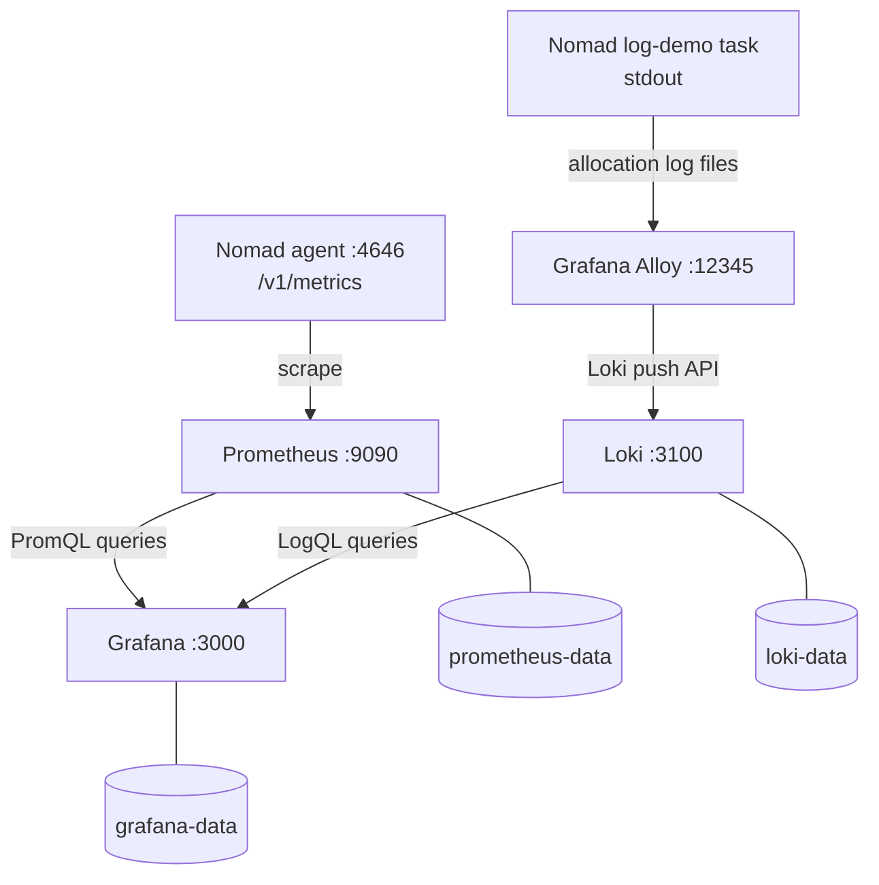

# Monitoring Stack: Prometheus, Grafana & Loki on Nomad

**Status:** Local single-node lab deployed and non-disruptively validated (observations from 7 November 2026, Asia/Karachi).
**Environment:** Ubuntu 26.04.1 LTS · HashiCorp Nomad 2.1.1 · Docker 29.9.3 · datacenter `dc1`.

## Executive summary

This project deploys a small observability stack using Nomad's Docker task driver. Prometheus scrapes the Nomad agent and its own metrics; Grafana shows metrics and logs; Grafana Alloy tails stdout logs from a co-located test application and pushes them to Loki. The stack operates on one Ubuntu host and exposes monitoring HTTP UIs only on loopback. Three Nomad host volumes store Prometheus, Loki, and Grafana data outside individual allocation lifecycles.

**Scope:** This is a functional local lab, not a hardened or highly available production observability platform. The logging collector has only been verified for the `nomad-log-demo` application. Host-wide CPU and memory utilization are not measured by the two dashboard panels named *Nomad Allocated CPU/Memory*; those panels show resource allocations.

## Architecture at a glance



For implementation details, see [Architecture](docs/ARCHITECTURE.md).

## Components

| Service | Image/version | Nomad job | HTTP bind | Purpose |
|---|---|---|---|---|
| Prometheus | `prom/prometheus:v3.13.5` | `prometheus` | `127.0.0.1:9090` | Scrape and query metrics |
| Loki | `grafana/loki:3.7.9` | `loki` | `127.0.0.1:3100` | Ingest and query logs |
| Grafana Alloy | `grafana/alloy:v1.21.3` | Task `alloy` in `nomad-log-demo` | `127.0.0.1:12345` | Tail and forward logs |
| Grafana | `grafana/grafana:13.3.0` | `grafana` | `127.0.0.1:3000` | Visualize metrics and logs |
| Log generator | `busybox:1.37.0` | Task `log-demo` in `nomad-log-demo` | N/A | Generate test messages |

The existing `rollback-demo-fixed` Docker container is outside the monitoring project's Nomad jobs; it was observed running and was not modified or tested by this project.

## Quick read-only verification

Run from the Ubuntu host:

```bash
cd ~/projects/nomad-monitoring
nomad server members
nomad node status
nomad job status
curl -fsS http://127.0.0.1:9090/-/ready; echo
curl -fsS http://127.0.0.1:3100/ready; echo
curl -fsS http://127.0.0.1:12345/-/ready; echo
curl -fsS http://127.0.0.1:3000/api/health; echo
```

Check current Prometheus targets using the HTTP API:

```bash
curl -fsS -G http://127.0.0.1:9090/api/v1/query \
  --data-urlencode 'query=up{job=~"nomad|prometheus"}' \
  | python3 -m json.tool
```

Check recent test logs:

```bash
curl -fsS -G http://127.0.0.1:3100/loki/api/v1/query_range \
  --data-urlencode 'query={job="nomad-log-demo"} |= "phase3-log-check"' \
  --data-urlencode 'since=10m' --data-urlencode 'limit=10' \
  | python3 -m json.tool
```

**Note:** A non-empty log result depends on the log-demo job still running and the time range containing new events.

## Grafana dashboard

Open on the same Ubuntu host: **http://127.0.0.1:3000/d/nomad-observability**. The provisioned dashboard is `Nomad Monitoring - Metrics and Logs` and has four panels:

1. Scrape Target Health — Prometheus metric `up` for `nomad` and `prometheus`.
2. Nomad Allocated CPU — `nomad_client_allocated_cpu` (allocation, not host load).
3. Nomad Allocated Memory — `nomad_client_allocated_memory` (allocation, not RAM used).
4. Nomad Application Logs — `{job="nomad-log-demo"} |= "phase3-log-check"`.

Data sources are provisioned as Prometheus (`http://127.0.0.1:9090`) and Loki (`http://127.0.0.1:3100`). Do not record Grafana credentials in this repository.

## Project layout

```text
nomad-monitoring/
├── jobs/
│   ├── prometheus.nomad.hcl
│   ├── loki.nomad.hcl
│   ├── alloy.nomad.hcl         # runs log-demo and Alloy tasks together
│   └── grafana.nomad.hcl
├── config/
│   ├── prometheus/prometheus.yml
│   ├── loki/loki.yaml
│   ├── alloy/config.alloy
│   └── grafana/provisioning/{datasources,dashboards}/
├── dashboards/nomad-observability.json
├── reports/phase5/           # locally collected test evidence (not bundled)
├── reports/phase6/           # documentation-only final report
├── screenshots/grafana-dashboard-verified.png  # user-provided UI evidence
├── docs/
└── README.md
```

File locations are based on the configuration commands used during setup; verify actual files in the local checkout before any redeployment.

## Documentation index

- [Architecture and data flows](docs/ARCHITECTURE.md)
- [Deployment history and safe verification guide](docs/DEPLOYMENT-AND-VERIFICATION.md)
- [Phase 5 validation report](docs/TEST-REPORT.md)
- [Operations, troubleshooting and limitations](docs/OPERATIONS-RUNBOOK.md)
- [Handover and delivery checklist](docs/DELIVERY-CHECKLIST.md)
- [Final completion summary](reports/phase6/FINAL-COMPLETION-REPORT.md)

## Safety and limitations

- All four monitoring HTTP endpoints were observed listening on `127.0.0.1`, but Nomad agent ports may have a different exposure policy. Inspect them separately.
- Nomad configuration validation earlier reported **mTLS not configured** and **bootstrap mode enabled**. Do not treat the cluster as production-secure.
- No forced failure, container replacement, backup restore, or post-restart data recovery test was performed.
- Static volumes provide mounted on-host storage; they are **not** proof of off-host backups or high availability.
- Alloy's positions data was configured under allocation storage, which can change when an allocation is replaced; duplicate/replayed log risk has not been tested.
- The test pipeline proves *one test application's* stdout ingestion, not cluster-wide logs. Do not put sensitive application information into log labels.
- The setup is a one-node demo; there are no demonstrated alerts, HA replicas, external authentication proxy, backup schedule or disaster recovery exercise.

## Authoritative references

- [Nomad job specs](https://developer.hashicorp.com/nomad/docs/job-specification)
- [Nomad Docker driver](https://developer.hashicorp.com/nomad/docs/deploy/task-driver/docker)
- [Nomad host volumes](https://developer.hashicorp.com/nomad/docs/architecture/storage/host-volumes)
- [Nomad allocation filesystems](https://developer.hashicorp.com/nomad/docs/concepts/filesystem)
- [Grafana provisioning](https://grafana.com/docs/grafana/latest/administration/provisioning/)
- [Loki retention](https://grafana.com/docs/loki/latest/operations/storage/retention/)
- [Prometheus query API](https://prometheus.io/docs/prometheus/latest/querying/api/)

## Quick Start

See [Installation and Setup](docs/QUICKSTART.md) for instructions to deploy this stack on another Ubuntu machine.
