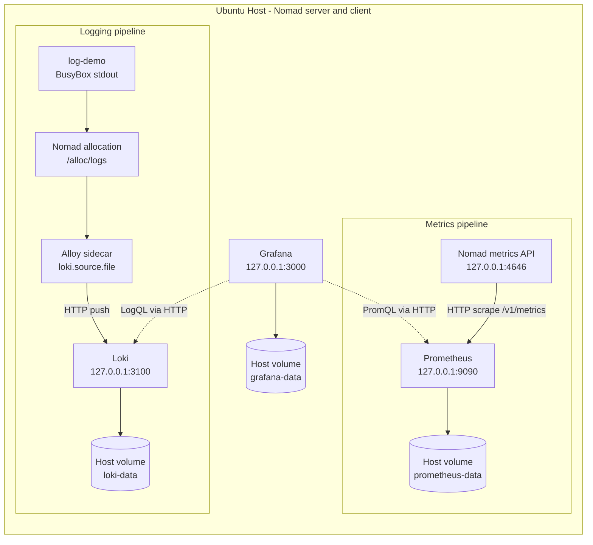

# Architecture and Data Flows

**Project:** Prometheus, Grafana, Loki & Alloy on Nomad
**Topology:** Single-node local development cluster on Ubuntu 26.04.1 LTS, `dc1`.
**Documentation date:** 7 November 2026 (Asia/Karachi).

## 1. Logical architecture

Nomad uses Docker for all monitoring tasks. The `nomad-log-demo` job contains two co-located tasks (`log-demo` and `alloy`) in one Nomad allocation. Alloy reads the allocation's stdout file; it does **not** require Docker socket access. The Grafana UI is accessed from the same host using loopback.

## 2. Detailed metrics flow

1. Nomad's `telemetry` block enables Prometheus-format metrics, including node/allocation metrics.
2. Prometheus scrapes its own `/metrics` endpoint and Nomad `/v1/metrics?format=prometheus` every 15 seconds.
3. The data is held in Prometheus's TSDB with the configured 7-day and 2-GB retention settings (storage usage is not a strict 2-GB filesystem quota).
4. Grafana's provisioned Prometheus data source uses `http://127.0.0.1:9090` over the shared host network.
5. The dashboard's health panel queries `up{job=~"nomad|prometheus"}`; CPU/memory panels query Nomad **allocated** resource metrics, not direct system utilization.

## 3. Detailed logging flow

1. BusyBox `log-demo` writes a `phase3-log-check` message approximately every 10 seconds.
2. Nomad writes stdout files into its allocation log directory under `/alloc/logs/`.
3. Alloy's `loki.source.file` component tails `log-demo.stdout.*` and adds labels such as `job`, `task`, and `source`.
4. Alloy's `loki.write.local` endpoint forwards entries to `http://127.0.0.1:3100/loki/api/v1/push`.
5. Loki stores log data in its mounted filesystem using a TSDB/v13 schema. Retention is configured to 168 hours via the compactor. The observed successful query proves ingestion for the test stream, not measured retention enforcement.
6. Grafana's Loki data source queries matching logs. The provisioned logs panel filters on `{job="nomad-log-demo"} |= "phase3-log-check"`.

## 4. Placement and storage

| Service | Nomad job/task | Container destination | Confirmed host path |
|---|---|---|---|
| Prometheus | `prometheus` | `/prometheus` | `/var/lib/nomad-monitoring/prometheus` |
| Loki | `loki` | `/loki` | `/var/lib/nomad-monitoring/loki` |
| Grafana | `grafana` | `/var/lib/grafana` | `/var/lib/nomad-monitoring/grafana` |
| Alloy | `alloy` task in `nomad-log-demo` | Allocation directory (positions) | Nomad-managed allocation storage; no persistent host volume proven |

Volume registration and actual container bind mounts were inspected on 7 November 2026. These checks establish mount configuration, **not** tested restart recovery or durable off-host backup.

## 5. Network and security boundary

| Endpoint | Observed listener | Intended scope |
|---|---|---|
| Grafana | `127.0.0.1:3000` | Local UI/API |
| Prometheus | `127.0.0.1:9090` | Local metrics UI/API |
| Loki HTTP | `127.0.0.1:3100` | Local log API |
| Alloy HTTP | `127.0.0.1:12345` | Local readiness/UI |
| Nomad HTTP | `*:4646` observed in Phase 1 | Nomad agent API; separate security review required |

The monitoring HTTP bindings were verified with `ss -lntp`. Loopback binding does not eliminate the need for Grafana credentials or Nomad cluster security. Nomad config validation showed `mTLS is not configured` and `Bootstrap mode enabled` warnings. Authentication, ACLs, backup policy and externally exposed routes have not been fully audited.

## 6. Deployment constraints and design trade-offs

- **Strengths:** Simple to understand; Nomad-managed Docker workloads; persistent host volumes for three data stores; file provisioning for Grafana; fully working local demo for metrics and logs.
- **Trade-offs:** All core services reside on one machine; loss of host can interrupt every pipeline. Host volumes do not guarantee availability on a different node.
- **Monitoring gap:** Only Prometheus and Nomad scrape targets are proven. There is no demonstrated application-specific exporter, host exporter, or alert rule.
- **Logging gap:** Only `nomad-log-demo` stdout is proven ingested. No evidence of Prometheus, Loki, Grafana or other application logs being ingested.
- **Recovery gap:** Failover, restart-based persistence, backup restoration, and Alloy positions recovery were intentionally not exercised.

